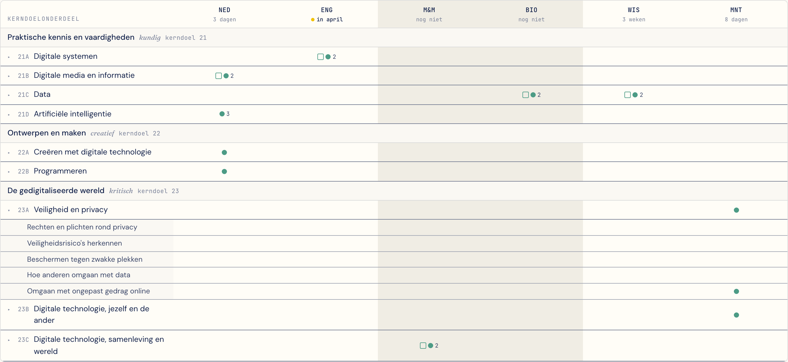
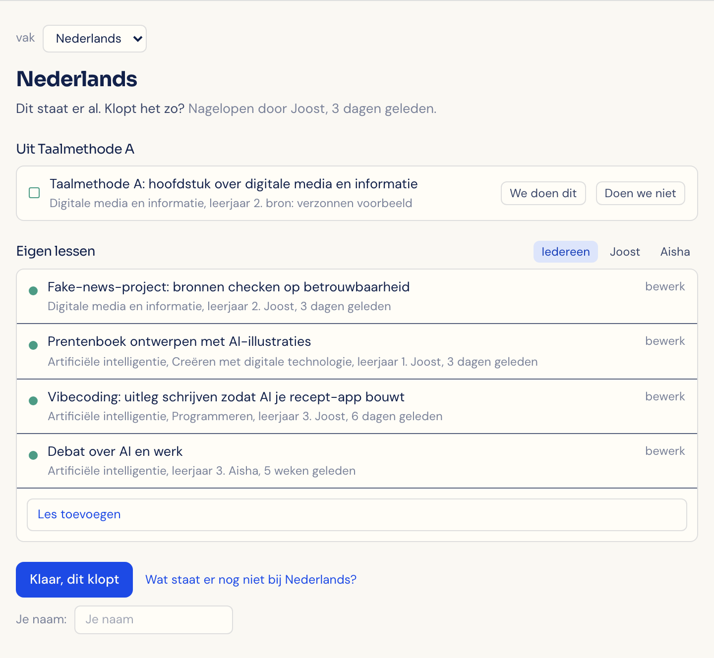

# Helder

**Which digital literacy goals come up in which lessons, and who says so?**

A small tool for Dutch schools. It shows where the national goals for digital literacy (the *kerndoelen digitale geletterdheid*) come up across subjects and school years. It keeps apart what comes from a textbook series (*methode*) and what teachers add themselves.

[Try the demo](https://helder.irisvandekieft.com/dekkingskaart). The school and everything in it is made up. The interface is in Dutch.



## Why I built it

From 1 August 2027 these goals are mandatory for Dutch schools. Many schools won't teach digital literacy as a separate subject, so the goals get spread over Dutch, biology, math and so on. That leaves one question nobody can easily answer: what are we already doing?

I started out wanting to build lesson material. Then I talked to teachers, coordinators and people around schools, and material turned out not to be the problem. The problem was the overview. People make one by hand in Excel, it takes hours, and it stops being true once the one person keeping it up stops pushing.

So this is a shared overview that a team keeps up together, and that shows when it's going out of date.

## Design decisions

- **The basic unit is a lesson activity, not a cell.** The map, the panels and the leerlijn are all views over one list of records. That's what makes adding and removing things possible. In my first version a cell was a calculated value, so there was nothing to edit.
- **It never says a goal is covered.** It shows who reported what, and when. Every line from a textbook series shows its source.
- **No score.** No percentage and no progress bar. A number invites people to report more generously than is true, and it turns an overview into a judgment.
- **Source is shown by shape.** An open square is the textbook series, a filled dot is a teacher. I tried color and left/right position first. Color suggested one source mattered more, and left/right was hard to read at this size.
- **Empty isn't a failure.** A shaded column means nobody has checked it yet. A white empty cell means someone checked and it doesn't happen there.
- **Teachers start with what's already there.** The teacher screen opens by asking "does this look right?", not with a list of what's missing. Gaps sit behind a link.
- **A school is a config file.** Goals, columns, years and teachers all live in one file, and a column doesn't have to be a subject. The second demo school tests this: a primary school with different goals, grade groups and project weeks, with no school-specific code.



## Status

This is a prototype. There's no backend, so changes are gone when you reload. There's no pupil data and no AI in the product. I'm trying it out with schools to learn what they need, and nobody is paying for it.

## Not yet

- Saving, logins and working together for real
- Separating this school year from next in the leerlijn
- Sub-goals for primary schools (secondary has them)

## Run it

```bash
npm install
npm run dev
```

The map is at `/`, and the primary school is at `/voorbeeldbasisschool`.

To add a school, copy a file in `src/dekkingskaart/scholen/` and register it in `index.ts`. The app is static, so everything in those files can be read by anyone with the site. Don't put real school data there.

## How it's built

Vite, React, TypeScript and Tailwind CSS. Built with Claude Code.

## Sources and license

The goals and sub-goals come from the SLO *Kerndoelen* books for primary and secondary education (2025, second printing), © SLO, which allows copying with credit. The latest version is at [slo.nl](https://www.slo.nl). SLO doesn't name the sub-goals, so the short names are mine.

The code is under the [MIT license](LICENSE). I can't promise to maintain it.
